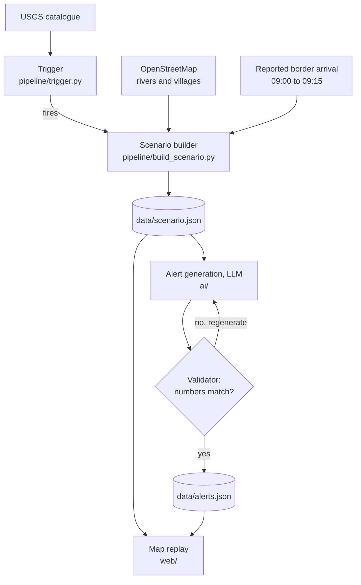

# Upstream Alert

Cross-border flood warnings from the first upstream signal.

> **This is a replay of a past event, not an operational warning system.** The scenario data in
> `data/scenario.json` is built from the USGS catalogue, OpenStreetMap and published reports (see
> [Sources](#sources)), and every number can be rebuilt with the scripts in `pipeline/`.

Built for **ForgeHacks 2026** (AI + Climate track) during the hackathon period, October 3–10, 2026.

## The problem

On August 26, 2026, a high-altitude ice-rock collapse just inside Nepal, at the head of a tributary
of the Lende Khola, sent a debris flow down the Lende Khola through Tibet's Gyirong port and back
into Nepal's Rasuwa district along the Bhote Koshi and Trishuli. The USGS recorded the collapse as a
magnitude 5.2 seismic event at 08:37 local time. The flood re-entered Nepal between about 09:00 and
09:15, and Nepali authorities first received word of it around 09:00. By 31 August, Nepal's disaster
authority had recorded 939 bodies recovered and 3,925 people missing. The flood crossed the border
twice, and no system is reported to have turned the upstream seismic signal into alerts for the
villages downstream.

## What this project does

Upstream Alert is a prototype of an upstream-triggered early warning system, demonstrated by
replaying the August 26 event:

1. **Trigger**: detects a collapse-like seismic event near glaciers or headwater rivers
   (magnitude 4 or more within 30 km of the upstream river).
2. **Routing**: estimates when the flood reaches each downstream village, as a time window
   calibrated against reported arrival times.
3. **Alerts**: an LLM writes short alerts in English and Nepali. All numbers come from the routing
   step, and a validator rejects any alert whose numbers do not match.

It does **not** forecast whether a flood will happen. It turns an upstream signal into
village-level alerts within minutes.

## How it works



- **Flood path**: the shortest path along the OpenStreetMap rivers named Lende Khola, Bhote Koshi and
  Trishuli, from the upstream signal down to Bidur (80.3 km). The USGS location is not on a mapped
  river, so the path starts with a 10.3 km straight-line leg standing in for the unmapped tributary
  where China's Ministry of Natural Resources places the collapse.
- **Villages**: seven places named in reports as hit, plus Haku Besi, which lies on the flood path
  between Syabru Bensi and Mailung, snapped to the flood path. All are within 1 km of it.
- **Arrival windows**: distance along the flood path divided by a constant speed band of
  33.3–55.2 km/h, calibrated so the flood reaches Rasuwa Gadhi between 09:00 and 09:15.

## Results

### Arrival windows

Minutes after the 08:37 upstream signal. The right-hand column is the sensitivity check: if the flood
is assumed to start at the Lende Khola rather than at the upstream signal, the speed band drops to
17.1–28.4 km/h and downstream windows are up to 1.7 times later. This is the largest uncertainty in
the model.

| Village | Distance on flood path (km) | Arrival window (min) | Without the 10 km leg (min) |
|---|---|---|---|
| Rasuwa Gadhi | 21.0 | 23–38 | 23–38 |
| Timure | 24.6 | 27–44 | 30–50 |
| Syabru Bensi | 35.8 | 39–65 | 54–90 |
| Haku Besi | 44.2 | 48–80 | 72–119 |
| Mailung | 53.6 | 58–97 | 91–152 |
| Shanti Bazar | 61.4 | 67–111 | 108–179 |
| Betrawati | 66.7 | 72–120 | 119–198 |
| Bidur | 78.3 | 85–141 | 144–239 |

### Trigger evaluation

`python pipeline/trigger.py` runs the trigger rule over every USGS event of magnitude 4 or more near
the upstream river from 2016 to 2026 (22 events). The rule does not use the USGS "landslide" label,
because USGS assigns it only after review: in real time the 26 August signal first appeared as an
earthquake.

| Radius from the Lende Khola | Alarms | Hits | False alarms |
|---|---|---|---|
| 10 km | 1 | 1 | 0 (misses the main 08:37 signal, 10.3 km away) |
| 20 km | 2 | 2 | 0 |
| **30 km (chosen)** | **2** | **2** | **0** |
| 50 km | 9 | 2 | 7 |

Both hits are 26 August events: the main signal and a magnitude 4.2 follow-up at 11:45. In 2015, the
aftershocks of the Gorkha earthquake would have set off 4 alarms. Caveats: there is only one real
collapse to test against, the radius was chosen knowing where it happened, and this measures false
alarms, not missed collapses.

### Alert evaluation

### Alert evaluation

`python -X utf8 ai/evaluate_alerts.py 20` asks the LLM (Claude Sonnet 5.5, `claude-sonnet-5-5`, via the
Claude Code CLI) for 20 first drafts per village, 160 in total, and checks each one before any
regeneration. Results are in `ai/eval_results.json`.

| Check | First drafts that pass |
|---|---|
| Both lead times correct and no other numbers, in English and Nepali | 160/160 |
| Village named in English and Nepali | 160/160 |
| All validator checks on the first try | 160/160 |

Alerts state the time left when the alert is sent, 1 minute after the signal, so each window is
1 minute shorter than in the arrival table above.

Zero failures in 160 drafts still allows a failure rate of up to about 1.9% (95% confidence), so the
validator stays in the loop. It checks numbers and names, not wording: an earlier prompt produced
Nepali instructions phrased as statements and one garbled sentence, all of which passed. The prompt
now asks for the polite command form.

## Limitations

- **One past event.** This replays a single flood; it is not a validated forecast.
- **One calibration point.** The border arrival time is used to fit the speed, so it cannot also
  check it. No downstream arrival times were found: reports say the Syabru Bensi and Betrawati river
  gauges stopped transmitting.
- **Constant speed.** A real flood wave changes speed and spreads out as it travels downstream.
- **Approximate source.** USGS locations for landslide signals are approximate, and the 10.3 km leg
  to the river is a straight line.
- **Alert delay.** The replay assumes the alert goes out 1 minute after the signal. Through the public
  USGS feed, the first version of the event appeared at 09:18, 41 minutes after the signal, as a
  magnitude 4.4 earthquake: the USGS 20-minute target for events outside the US applies only from
  magnitude 5. The trigger rule still fires on that first version (15.5 km from the Lende Khola), but
  only after the flood had crossed into Nepal. A delay of minutes would need direct processing of
  seismometer data.
- **Reviewed catalogue.** The trigger is evaluated on the reviewed USGS catalogue. Real-time
  magnitudes and locations differ: the first version was 31 km further north and listed at
  magnitude 4.4 instead of 5.2.
- **Unreviewed Nepali.** The Nepali alerts are machine-generated and have not been reviewed by a
  native speaker. The validator checks their numbers and village names, not their wording.
- **Floods that don't shake the ground.** The trigger needs a catalogued seismic event. The
  8 July 2025 flood in the same valley, which destroyed the Miteri Bridge at Rasuwagadhi, has no USGS
  event, so the rule would have missed it.

## Repository layout

| Folder | Contents |
|---|---|
| `web/` | Map replay (Leaflet) |
| `data/` | Hand-off files between modules, plus `validate_scenario.py` |
| `pipeline/` | GIS export, calibration, trigger and trigger evaluation |
| `ai/` | Alert generation, validation and evaluation |

## Run locally

From the repo root (the page reads `../data/scenario.json` and `../data/alerts.json`):

```
python -m http.server 8765
```

Then open http://localhost:8765/web/. Opening the HTML file directly (`file://`) blocks the data files
and the base map tiles.

Rebuild the scenario, validate the data contract and run the trigger evaluation (Python 3, no
third-party packages):

```
python pipeline/build_scenario.py
python data/validate_scenario.py
python pipeline/trigger.py
```

Generate, validate and evaluate the alerts (needs the Claude Code CLI, logged in; see `ai/README.md`):

```
python ai/generate_alerts.py
python ai/validate_alerts.py
python ai/evaluate_alerts.py 5
```

On Windows, add `-X utf8` (for example `python -X utf8 ai/generate_alerts.py`); the alerts contain Devanagari text.

## Team

- Yunhong Huang: AI layer, frontend, integration
- Chenxi Liu: data pipeline, GIS, calibration, trigger evaluation

## Sources

Data:

- USGS events [us7000tbwb](https://earthquake.usgs.gov/earthquakes/eventpage/us7000tbwb) (M5.2, 08:37)
  and [us7000tc90](https://earthquake.usgs.gov/earthquakes/eventpage/us7000tc90) (M4.2, 11:45), and the
  [USGS FDSN event API](https://earthquake.usgs.gov/fdsnws/event/1/) for the trigger evaluation and the
  publication time of the first version of the event.
- USGS, [National Earthquake Information Center](https://www.usgs.gov/programs/earthquake-hazards/national-earthquake-information-center-neic):
  20-minute release target for events of magnitude 5 or more outside the US.
- Rivers and villages: © [OpenStreetMap](https://www.openstreetmap.org/copyright) contributors,
  available under the Open Database License (ODbL), via the [Overpass API](https://overpass-api.de/).

Reports:

- Borderlens, [Massive flash flood from Tibet devastates Nepal's Rasuwa district](https://www.borderlens.com/2026/08/26/massive-flash-flood-from-tibet-devastates-nepals-rasuwa-district-nepals-deepening-climate-challenge/),
  2026-08-26: flood entered Nepal around 09:00; cross-border early warning gap.
- Nepal Red Cross Society, [Rasuwa Flood Situation Update (26 August 2026)](https://nrcs.org/resources/news-and-events/rasuwa-flood-situation-update-26-august-2026/):
  surge entered the Bhote Koshi at about 09:15.
- NovaNews (AFP), [Experts: Glacier collapse may have caused Nepal-Tibet flooding](https://novanews.co.za/experts-glacier-collapse-may-have-caused-nepal-tibet-flooding/),
  2026-08-27: the 08:37 seismic signal; authorities received word around 09:00.
- Crossroads Foundation, [2026 Nepalese Flood](https://www.crossroads.org.hk/2026-nepalese-flood/):
  collapse near Langtang Lirung.
- NESRA, [FloodWatch: Rasuwa 2026](https://nesraspace.org/floodwatch/rasuwa-2026/): Syabru Bensi and
  Betrawati gauges stopped transmitting.
- Science and Technology Daily (科技日报), [自然资源部：西藏吉隆泥石流由尼泊尔境内高山冰崩引发](https://www.stdaily.com/web/gdxw/2026-08/28/content_571025.html),
  2026-08-28: China's Ministry of Natural Resources places the collapse inside Nepal, on a tributary of
  the Lende Khola upstream of Gyirong port.
- Spotlight Nepal, [Rasuwa Floods: 939 Bodies Recovered by Monday Evening, 3,925 People Missing](https://www.spotlightnepal.com/2026/08/31/rasuwa-floods-939-bodies-recovered-monday-evening-3925-people-missing/),
  2026-08-31, citing Nepal's National Disaster Risk Reduction and Management Authority; also reported by
  the [BBC](https://www.bbc.com/news/live/cwrk34rzx3z2t).
- Eos, The Landslide Blog, [Rasuwagadhi](https://eos.org/thelandslideblog/rasuwagadhi-1), 2025-07-09: the
  8 July 2025 flood in the same valley.
